# 音樂宇宙 · Spatial Nexus

一個以星系與聲音為材料的即時三維互動地圖。首頁現在是一座可環繞、可穿越的 **3D 星際樞紐**：

- **3D Spatial Nexus**：自訂著色器核心、程序化幾何、粒子、體積光、景深與宇宙節點。
- **宇宙 I · 藝術音樂**：螺旋星系，七個西方藝術音樂時代，每個行星是一座獨立小世界。
- **宇宙 II · 流行聲響**：環形星系，七個流行類型，每顆行星是一座旋轉唱片式的聲音艙。
- **宇宙 III · 媒介宇宙**：訊號網絡，七種音樂媒介，每顆行星是一座媒體檔案室。

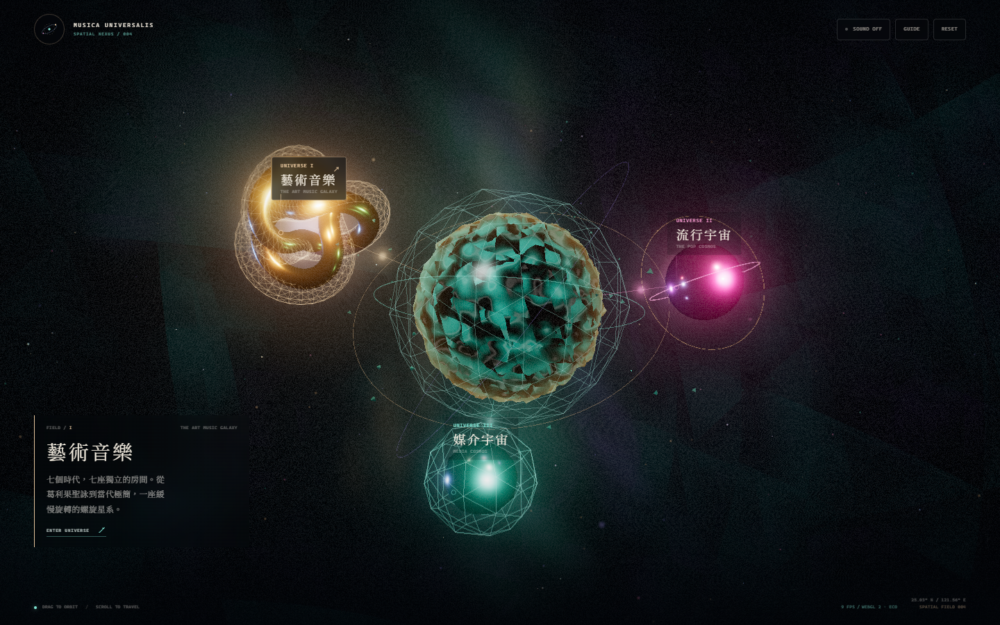

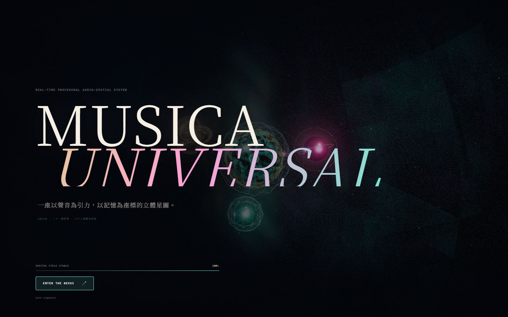

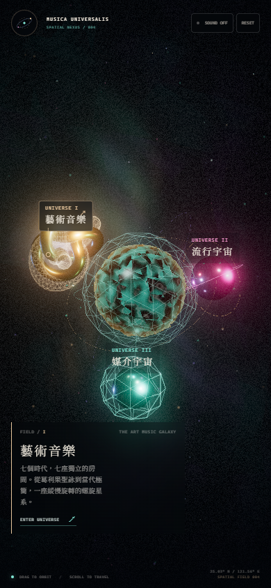

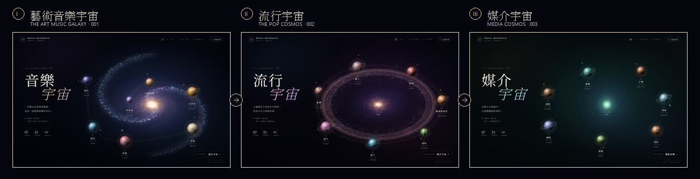

## 立即開啟

直接雙擊 `index.html` 即可（無需安裝、無外部依賴、無需連網）。若裝置不支援 WebGL 2，仍可進入 [`classic.html`](classic.html) 的經典二維藝術音樂星圖。

內容宇宙也可直接開啟：

- [`classic.html`](classic.html) — 宇宙 I · 藝術音樂
- [`universe-2.html`](universe-2.html) — 宇宙 II · 流行宇宙
- [`universe-3.html`](universe-3.html) — 宇宙 III · 媒介宇宙

若想用本機伺服器開啟：

```bash
python -m http.server 8123
# 然後打開 http://127.0.0.1:8123/
```

## 3D 星際樞紐

首頁不是靜態背景：它是一個由 Three.js、自訂 GLSL 著色器與即時後處理構成的完整場景。

- 中央核心以 simplex noise 進行頂點位移，具有 iridescent rim light、動態高光、能量紋理與程序化拆解碎片。
- 三座宇宙是三個可互動的 3D 節點；拖曳空白處環繞相機，滾輪推進／拉遠，點擊節點進入宇宙。
- 拖曳核心可旋轉；`Shift + 拖曳` 可拉伸；雙擊或按 `E` 可拆解核心並重組。
- 自訂游標會感應滑鼠速度、位置與軌跡，並在宇宙節點與控制項上產生磁吸與放大回饋。
- 圖形管線包含景深（Bokeh）、泛光、動態殘影、色差、空間徑向畸變、暗角與底片顆粒。
- 效能會自動調整：偵測到軟體渲染或低幀率時，會關閉較重的後處理與陰影並降低解析度。

| 操作 | 效果 |
| --- | --- |
| 拖曳空白處 | 環繞星際樞紐 |
| 拖曳中央核心 | 旋轉核心 |
| `Shift + 拖曳` 核心 | 拉伸核心 |
| 滾輪 / 雙指縮放 | 推進或拉遠景深 |
| 雙擊核心 / `E` | 拆解核心 |
| 點擊宇宙節點 | 穿越至該宇宙 |
| `1` / `2` / `3` | 前往三座宇宙 |
| `R` | 重置視角 |
| `M` | 開關程序化環境音 |
| `?` / `Shift + /` | 開啟控制指南 |
| `Esc` | 收起指南 |

內容頁右上角的 **NEXUS** 連結會回到 3D 樞紐；`I / II / III` 可直接跳到三座內容宇宙。

## 前往下一個宇宙

| 位置 | 操作 |
| --- | --- |
| 3D 樞紐 | 點擊 `I / II / III` 宇宙節點，穿越至 `classic.html`、`universe-2.html`、`universe-3.html` |
| 宇宙 I 右下角 | `NEXT UNIVERSE / 流行宇宙 ↗` → 進入 `universe-2.html` |
| 宇宙 II 右下角 | `NEXT UNIVERSE / 媒介宇宙 ↗` → 進入 `universe-3.html` |
| 宇宙 III 右下角 | `NEXT UNIVERSE / 藝術音樂 ↗` → 回到 `classic.html` |
| 內容頁右上角 | `NEXUS` 回到 3D 樞紐；`I / II / III` 直接跳轉內容宇宙 |
| 內容頁右上角 | 可重播該星系的生成動畫 |

內容宇宙形成一個循環：**I → II → III → I**；3D 樞紐則是這個循環的入口與返回點。切換內容宇宙時會先進入一段**模擬星際載入畫面**：畫面會顯示起點／終點星圖、目標宇宙、旋轉軌道、載入進度與狀態文字，完成後才真正載入。三座星系各自保留自己的行星、世界、曲目與聲音。

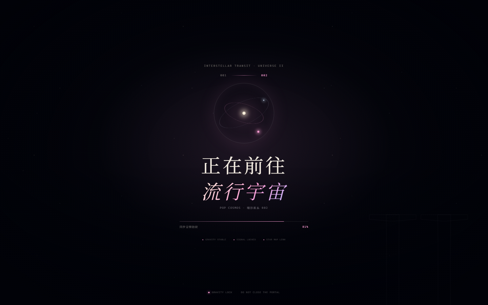

載入流程約 2.4 秒，狀態依序為「建立星際航道 → 壓縮星系座標 → 同步音樂指紋 → 校準引力入場角 → 準備進入宇宙」。若系統開啟 `prefers-reduced-motion`，會縮短載入並停用軌道動畫。

## 操作方式

| 操作 | 效果 |
| --- | --- |
| 等待開場動畫，或按「跳過序章」 | 進入星系 |
| 點擊行星 | 進入該行星所屬的獨立世界 |
| 點擊世界中的三條支流 | 切換分支內容與對應的真實歷史曲目，整個世界的光線與配色也會回應 |
| 播放按鈕 | 播放目前分支的曲目；未填入音源時以 Web Audio 作風格示意 |
| 底部上／下一個世界 | 宇宙 I 切換時代；宇宙 II 切換類型；宇宙 III 切換媒介 |
| `Esc` | 返回銀河 |
| `←` / `→` | 在非分支按鈕上時切換世界；在分支按鈕上時切換分支 |
| 右上角「重播序章」 | 重新播放星系生成動畫 |

在每個世界裡，`Tab` 焦點會被限制在世界面板內，關閉後回到對應的行星。行星不會跟著滑鼠移動；銀河是一張穩定的星圖，而不是視差背景。

## 宇宙 I · 星球外表 ↔ 世界內部

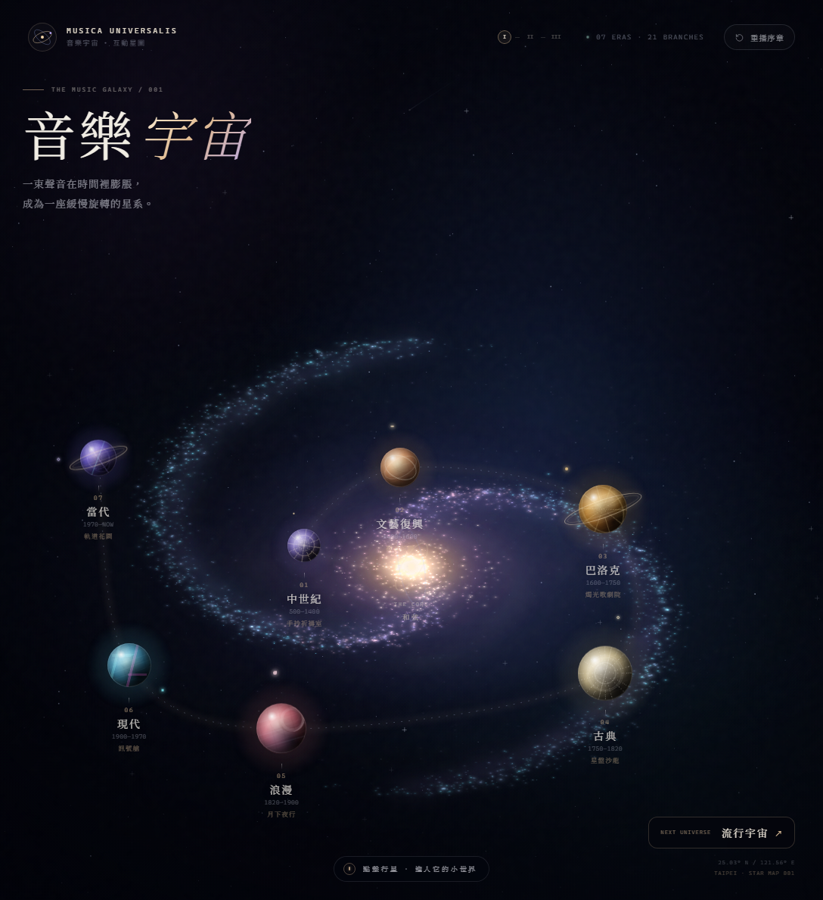

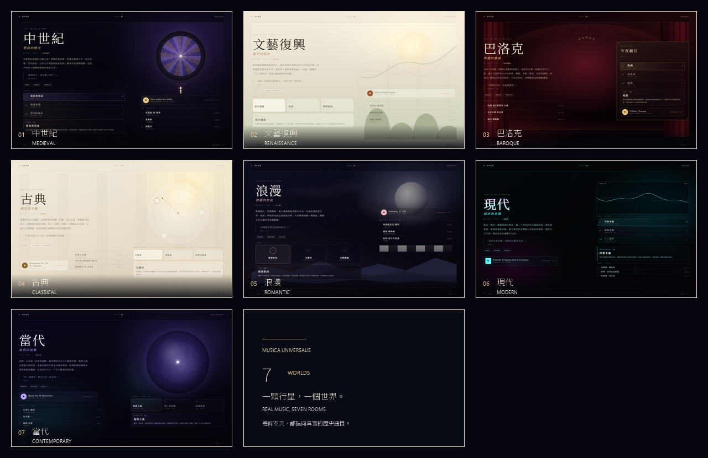

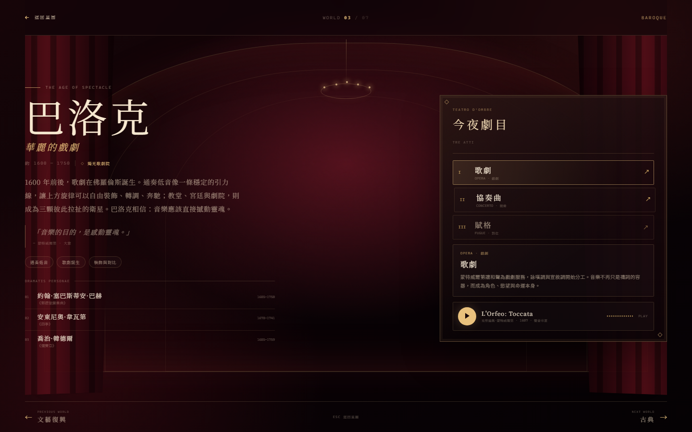

行星不只是色球：每顆行星的表面紋理都引用它內部的小世界，並且在標籤上直接寫出世界名稱。

| 行星 | 星球表面細節 | 對應的內部世界 |
| --- | --- | --- |
| 中世紀 | 玫瑰窗放射玻璃、金色窗櫺 | 手抄祈禱室 |
| 文藝復興 | 交叉聲部絲帶、花園色塊 | 複音花園 |
| 巴洛克 | 金色舞台弧線、聚光環 | 燭光歌劇院 |
| 古典 | 星盤刻度、同心軌道 | 星盤沙龍 |
| 浪漫 | 月牙陰影、雲雨條紋 | 月下夜行 |
| 現代 | 青／洋紅故障切面 | 訊號艙 |
| 當代 | 軌道網格與訊號環 | 軌道花園 |

行星標籤上的「手抄祈禱室」、「複音花園」等名稱，會在世界內標題下方再次出現；分支則直接對應播放器中的真實歷史曲目。

## 行星的動態簽名

每顆行星現在都有兩層動態：表面紋理以自己的節奏運動，外圍則有一顆專屬衛星以不同速度、軌道半徑與形狀繞行。衛星會隨行星的公轉角度出現在不同位置，但不會攔截點擊。

| 行星 | 表面動態 | 衛星 |
| --- | --- | --- |
| 中世紀 | 玫瑰窗緩慢旋轉 | 金色菱形 |
| 文藝復興 | 兩條聲部絲帶交替呼吸 | 長橢圓光點 |
| 巴洛克 | 金色弧線旋轉並明滅 | 金色圓點 |
| 古典 | 星盤刻度旋轉、內環脈動 | 空心金環 |
| 浪漫 | 月牙緩慢漂移 | 玫瑰色水滴 |
| 現代 | 青色／洋紅切面隨機閃爍 | 青色方塊 |
| 當代 | 軌道網格旋轉、訊號環脈動 | 紫色空心環 |

宇宙 II 的七顆類型行星也各有動態：藍調的弦線震動、爵士的煙圈擴散、搖滾的閃電閃爍、靈魂的日芒旋轉、嘻哈的方塊跳格、電子的電路掃描，以及流行的星芒旋轉；外圍同樣各有一顆不同形狀的衛星。

宇宙 III 的七顆媒介行星則以媒介本身作為動態：黑膠唱片旋轉、廣播指針掃頻、卡帶捲軸轉動、電視掃描線閃爍、電影膠片跑格、遊戲像素跳動、網路資料流掃描。衛星也各自對應為圓點、空心環、方塊、菱形或星芒。

## 宇宙 I · 七個世界，七種房間

| 行星 | 時代 | 小型世界 | 三條支流 |
| --- | --- | --- | --- |
| 01 | 中世紀（約 500—1400） | 手抄本祈禱室：玫瑰窗、燭火、羊皮紙手稿 | 葛利果聖詠、奧爾加農、聖母院複音 |
| 02 | 文藝復興（約 1400—1600） | 複音花園：日光、拱廊、四條交織的聲部絲帶 | 複音彌撒、牧歌、器樂舞曲 |
| 03 | 巴洛克（約 1600—1750） | 燭光歌劇院：鏡框舞台、紅絲絨幕、吊燈與劇目單 | 歌劇、協奏曲、賦格 |
| 04 | 古典（約 1750—1820） | 理性沙龍：象牙色日光、柱廊、機械星盤 | 交響曲、奏鳴曲、弦樂四重奏 |
| 05 | 浪漫（約 1820—1900） | 月下夜行：月亮、霧氣、山影、雨絲與鋼琴 | 藝術歌曲、交響詩、音樂戲劇 |
| 06 | 現代（約 1900—1970） | 訊號艙：故障標題、碎片、即時示波器 | 印象主義、原始主義、十二音列 |
| 07 | 當代（1970—現在） | 軌道花園：發光球體、軌道環、訊號節點 | 極簡主義、電子與氛圍、影像配樂 |

每個世界包含：獨立的場景構成、時代關鍵字、三位代表作曲家、三條分支，以及可切換的真實歷史曲目與聲音示意。分支選擇會改變該世界的燈光、色溫、月光、星盤指針或示波器波形。

## 宇宙 I · 歷史曲目

目前每一條支流都對應一首真實存在的歷史作品；選擇分支後，播放器會同步顯示該曲目與作曲家／年代。

| 世界 | 三首曲目 |
| --- | --- |
| 中世紀 | *Puer natus est nobis*（匿名葛利果聖詠，約 9 世紀）<br>*Viderunt omnes*（萊奧寧，約 1160–1180）<br>*Sederunt principes*（佩羅坦，約 1199） |
| 文藝復興 | *Missa Pange lingua*（若斯坎·德普雷，約 1515）<br>*Il bianco e dolce cigno*（阿卡德爾特，1539）<br>*Belle qui tiens ma vie*（阿爾博，1589） |
| 巴洛克 | *L'Orfeo: Toccata*（蒙特威爾第，1607）<br>*The Four Seasons: Spring*（韋瓦第，1725）<br>*Fugue in C major, BWV 846*（巴赫，1722） |
| 古典 | *Symphony No. 94: II. Andante*（海頓，1791）<br>*Rondo alla turca, K. 331*（莫札特，1783）<br>*String Quartet Op. 18 No. 4*（貝多芬，1800） |
| 浪漫 | *Erlkönig, D. 328*（舒伯特，1815）<br>*Les Préludes, S. 97*（李斯特，1854）<br>*Tristan: Prelude & Liebestod*（華格納，1865） |
| 現代 | *Prélude à l'après-midi d'un faune*（德布西，1894）<br>*The Rite of Spring: Adoration*（史特拉汶斯基，1913）<br>*Suite for Piano, Op. 25*（荀白克，1923） |
| 當代 | *Music for 18 Musicians*（賴希，1976）<br>*Music for Airports — 1/1*（伊諾，1978）<br>*Merry Christmas, Mr. Lawrence*（坂本龍一，1983） |

播放器顯示的是曲目資料；目前所有曲目預設 `src: null`，所以會播放即時合成的**風格示意**，而不是該曲的歷史錄音。你可以直接自己加音源：

```js
// app.js 中每個時代的 tracks 陣列
{
  title: 'Puer natus est nobis',
  composer: '匿名的葛利果聖詠傳統',
  year: '約 9 世紀',
  note: '聖誕彌撒進堂詠',
  src: 'audio/puer-natus-est-nobis.mp3' // 填上你自己的錄音路徑
}
```

填入 `src` 後，播放器會改用該音檔，並在介面標示「歷史錄音」。把檔案放在 `music-universe/audio/` 之類的相對路徑即可。

## 宇宙 II · 流行聲響

第二座星系是一圈由七個流行類型組成的環形星圖。每顆行星進入一座「聲音艙」：黑膠唱片轉動、曲目在標籤上顯示，三條聲軌各對應一首真實作品。

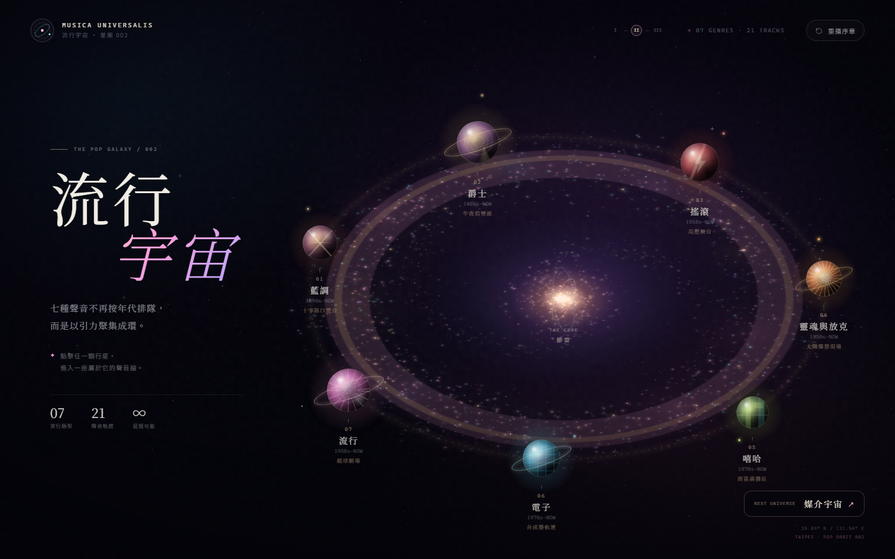

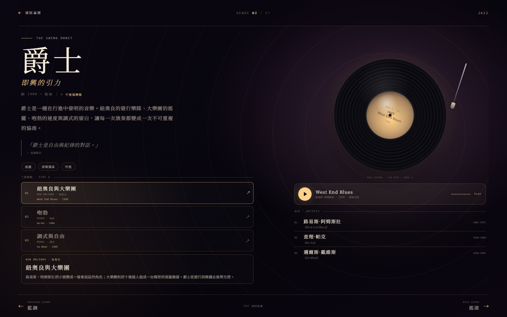

| 行星 | 類型 | 聲音艙 | 三條聲軌 |
| --- | --- | --- | --- |
| 01 | 藍調（1890s—NOW） | 十字路口電台 | 三角洲藍調、芝加哥藍調、電藍調 |
| 02 | 爵士（1900s—NOW） | 午夜俱樂部 | 紐奧良與大樂團、咆勃、調式與自由 |
| 03 | 搖滾（1950s—NOW） | 高壓舞台 | 搖滾樂誕生、迷幻與藍調搖滾、龐克與另類 |
| 04 | 靈魂與放克（1950s—NOW） | 太陽爆發現場 | 靈魂樂的黃金年代、南方靈魂、放克革命 |
| 05 | 嘻哈（1970s—NOW） | 街區廣播站 | 街頭派對、黃金年代、全球擴散 |
| 06 | 電子（1970s—NOW） | 合成器軌道 | 合成器流行、浩室與鐵克諾、IDM 與氛圍 |
| 07 | 流行（1950s—NOW） | 鏡球劇場 | 流行歌曲工廠、巨星時代、串流與全球化 |

### 宇宙 II · 曲目

| 類型 | 三首真實作品 |
| --- | --- |
| 藍調 | *Cross Road Blues*（羅伯·強森，1936）<br>*Hoochie Coochie Man*（馬迪·沃特斯，1954）<br>*The Thrill Is Gone*（B.B. King，1969） |
| 爵士 | *West End Blues*（路易斯·阿姆斯壯，1928）<br>*Ko-Ko*（查理·帕克，1945）<br>*So What*（邁爾斯·戴維斯，1959） |
| 搖滾 | *Johnny B. Goode*（查克·貝瑞，1958）<br>*Purple Haze*（吉米·罕醉克斯，1967）<br>*London Calling*（The Clash，1979） |
| 靈魂與放克 | *Respect*（艾瑞莎·弗蘭克林，1967）<br>*Try a Little Tenderness*（奧提斯·瑞丁，1966）<br>*Sex Machine*（詹姆斯·布朗，1970） |
| 嘻哈 | *The Message*（Grandmaster Flash & The Furious Five，1982）<br>*C.R.E.A.M.*（Wu-Tang Clan，1993）<br>*Alright*（Kendrick Lamar，2015） |
| 電子 | *Autobahn*（Kraftwerk，1974）<br>*Your Love*（Frankie Knuckles & Jamie Principle，1986）<br>*Windowlicker*（Aphex Twin，1999） |
| 流行 | *I Want to Hold Your Hand*（The Beatles，1963）<br>*Billie Jean*（麥可·傑克森，1982）<br>*Crazy in Love*（Beyoncé feat. Jay-Z，2003） |

宇宙 II 的曲目資料在 [`pop.js`](pop.js) 的 `GENRES` 陣列中，同樣支援 `src`；填入路徑後即可換成你的音源。分支按鈕會直接顯示該支流的曲目，選擇後黑膠標籤與播放器同步更新。

## 宇宙 III · 媒介宇宙

第三座星系不是按時代或類型排列，而是由七種**音樂媒介**組成：黑膠、廣播、卡帶、電視、電影、遊戲、網路。行星之間以發光的訊號線連成一座網絡，中心是一顆持續向外發射無線電波的訊號核心。

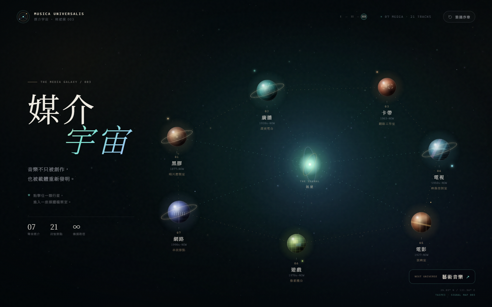

每顆行星進入一座媒體檔案室。右側會出現該媒介的專屬物件：黑膠唱盤、收音機、卡式錄音座、CRT 電視、電影放映機、掌機或手機；下方同步顯示目前曲目與年份。

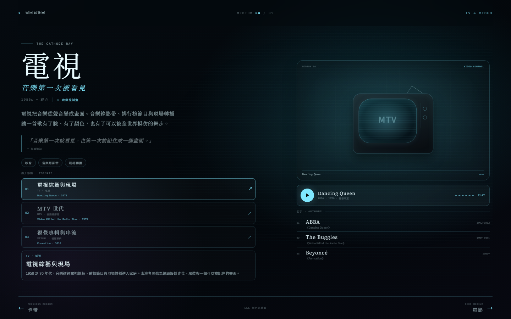

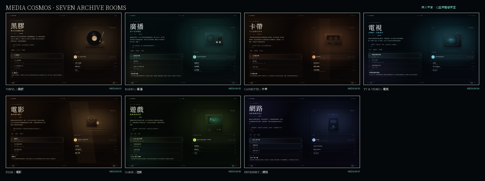

| 行星 | 媒介 | 檔案室 | 三種媒介形態 |
| --- | --- | --- | --- |
| 01 | 黑膠（1877—NOW） | 唱片壓製室 | 78 轉唱片、33⅓ 轉 LP、12 吋單曲與 DJ |
| 02 | 廣播（1920s—NOW） | 深夜電台 | 家庭收音機、海盜電台、夜間 FM |
| 03 | 卡帶（1963—NOW） | 翻錄工作室 | 卡式錄音帶、隨身聽、Mixtape |
| 04 | 電視（1950s—NOW） | 映像控制室 | 電視綜藝、MTV、視覺專輯 |
| 05 | 電影（1927—NOW） | 放映室 | 歌舞片、作者電影配樂、聲音設計 |
| 06 | 遊戲（1970s—NOW） | 像素機台 | 8-bit 晶片音樂、交響配樂、互動氛圍 |
| 07 | 網路（1990s—NOW） | 串流節點 | MP3 下載、串流平台、短影音與 AI |

### 宇宙 III · 曲目

| 媒介 | 三首真實作品 |
| --- | --- |
| 黑膠 | *St. Louis Blues*（貝西·史密斯，1925）<br>*A Love Supreme, Pt. I*（約翰·柯川，1965）<br>*Good Times*（Chic，1979） |
| 廣播 | *Good Vibrations*（海灘男孩，1966）<br>*Waterloo Sunset*（奇想樂團，1967）<br>*Bohemian Rhapsody*（皇后樂團，1975） |
| 卡帶 | *Dreams*（佛利伍麥克，1977）<br>*Sweet Dreams (Are Made of This)*（舞韻合唱團，1983）<br>*There Is a Light That Never Goes Out*（史密斯樂團，1986） |
| 電視 | *Dancing Queen*（ABBA，1976）<br>*Video Killed the Radio Star*（The Buggles，1979）<br>*Formation*（Beyoncé，2016） |
| 電影 | *Singin' in the Rain*（金·凱利，1952）<br>*The Pink Panther Theme*（亨利·曼西尼，1963）<br>*Time*（漢斯·季默，2010） |
| 遊戲 | *Super Mario Bros. Theme*（近藤浩治，1985）<br>*One-Winged Angel*（植松伸夫，1997）<br>*Sweden*（C418，2011） |
| 網路 | *Crazy*（Gnarls Barkley，2006）<br>*bad guy*（Billie Eilish，2019）<br>*Old Town Road*（Lil Nas X，2019） |

宇宙 III 的曲目與媒介資料在 [`media.js`](media.js) 的 `MEDIA` 陣列中，同樣支援 `src`。每個媒介物件的動畫與配色定義於 [`media.css`](media.css)。

## 技術說明

- **零依賴**：`index.html`、`classic.html`、`universe-2.html`、`universe-3.html` 與對應的 CSS/JS；Three.js 已打包進 `nexus.bundle.js`，沒有執行期 CDN、圖片或音訊檔。
- **3D 星際樞紐**：Three.js + 自訂 GLSL。中央核心以 simplex noise 位移頂點，配合 iridescent fresnel、動態高光、能量紋理與 InstancedMesh 碎片；三座宇宙是獨立 3D 節點，並以加入式光暈、軌道環與連線串起。
- **後處理**：`EffectComposer` 管線包含 Bokeh 景深、Unreal Bloom、Afterimage 動態殘影，以及自訂色差／徑向畸變／暗角／底片顆粒 pass；在低效能或軟體渲染時自動關閉重效果並降低 DPR。
- **空間互動**：自訂 orbit rig（阻尼、慣性、指標視差、滾輪 dolly）、核心拖曳旋轉、Shift 拉伸、爆炸重組、節點 hover 與 warp 相機過場；自訂游標包含拖尾、速度與磁吸。
- **程序化氛圍**：背景 fBm 星雲、三層星場、塵埃粒子、放射性訊號環、體積光柱、核心光暈與動態高光；所有紋理由 shader 或 Canvas 即時生成，沒有預渲染影片。
- **宇宙 I · 螺旋星系**：Canvas 2D。約 1,700—3,650 顆程序化星點，分佈於雙螺旋臂、核球與瀰散盤；快取星雲、螺旋光帶與 `destination-out` 暗塵帶疊出層次；進場時星點向內收束、加速旋轉後定形。
- **宇宙 II · 環形星系**：另一套 Canvas 2D 生成器，以玫瑰、金色、青色星點形成環狀星團與核心；七顆類型行星排列在環形軌道上，形成與宇宙 I 不同的天體結構。
- **宇宙 III · 訊號網絡**：第三套 Canvas 2D 生成器，以青綠、金色與藍紫星點、擴散無線電環與數據微粒構成背景；七顆媒介行星以不規則節點排列，並以 SVG 光束與外圍連線組成訊號網絡。
- **行星系統**：內容宇宙使用 HTML/CSS 行星與行星環，位置由幾何計算；宇宙 I 的 SVG 航道串起七個時代，宇宙 II 是一條閉合環，宇宙 III 是中心向外輻射的訊號網。每顆行星有專屬的表面動態與衛星軌道，游標移動不會改變星系位置。
- **三種房間格式**：宇宙 I 是七個專屬小世界（手抄祈禱室、複音花園、歌劇院、星盤沙龍、月下夜行、訊號艙、軌道花園）；宇宙 II 是七座「黑膠聲音艙」；宇宙 III 是七座「媒體檔案室」，分別使用黑膠唱盤、收音機、卡式錄音座、CRT 電視、放映機、掌機與手機等 CSS 物件。
- **宇宙切換與模擬載入**：內容宇宙的 `NEXT UNIVERSE` 會啟動約 2.4 秒的星際轉運畫面；3D 樞紐的節點則使用相機 warp 與閃光過場。內容宇宙形成 **I → II → III → I** 的循環，3D 樞紐是入口與返回點。
- **互動狀態**：分支內容以共用資料驅動，但每個世界各自的 CSS 會改變光線、色彩、指針、月亮、波形、黑膠標籤或媒介物件；世界切換使用淡出／淡入。
- **轉場**：內容宇宙以行星位置為圓心的 `clip-path` 擴張；3D 樞紐以相機推進、節點放大、色差與徑向畸變完成穿越；`prefers-reduced-motion` 時退化為靜態呈現。
- **聲音**：內容宇宙的每個分支對應真實歷史曲目的 metadata；`track.src` 為空時以 Web Audio 即時合成風格示意。3D 樞紐另有可開關的程序化環境音，並將分析值回饋至核心與粒子。
- **響應式**：desktop / tablet / portrait / mobile 四種佈局；內容宇宙驗證 1920×1080、1440×900、1366×768、1088×1188（直向）、1024×768、900×800、390×844；3D 樞紐驗證 1440×900、1366×768、390×844。
- **無障礙**：行星、分支與宇宙節點皆為真正的 button；世界面板使用 `role="dialog"`、`aria-modal`、`inert` 背景與焦點圈限；3D 節點提供文字標籤與鍵盤操作；尊重減少動態偏好。
- **字型**：優先使用系統安裝的 Noto Serif TC / Noto Sans TC，並提供中英文 fallback。

## 檔案結構

```
music-universe/
├── index.html            3D Spatial Nexus（即時 WebGL 入口）
├── classic.html          宇宙 I · 藝術音樂（螺旋星系）
├── universe-2.html       宇宙 II · 流行聲響（環形星系）
├── universe-3.html       宇宙 III · 媒介宇宙（訊號網絡）
├── nexus.css             3D 樞紐介面、游標、HUD 與響應式
├── nexus.bundle.js       Three.js 場景、shader、後處理與互動（已打包）
├── 3d-build/src/nexus.js 3D 場景原始碼
├── styles.css            內容宇宙共用主視覺、行星、開場、基礎互動
├── app.js                宇宙 I 資料、星系生成、Web Audio、行星入口
├── worlds.css            宇宙 I 七個小世界視覺與響應式
├── worlds.js             宇宙 I 世界模板、分支、音訊與焦點管理
├── pop.css               宇宙 II 環形星系與七座聲音艙
├── pop.js                宇宙 II 資料、環形星系、黑膠世界與音訊
├── media.css             宇宙 III 訊號網絡、媒介行星與七座檔案室
├── media.js              宇宙 III 資料、訊號網絡、媒介物件與音訊
├── universe-nav.css      內容宇宙切換、模擬載入與 NEXUS 連結
├── universe-nav.js       內容宇宙切換載入流程控制
├── preview-nexus.png     3D 樞紐主畫面
├── preview-nexus-intro.png 3D 樞紐序章
├── preview-nexus-mobile.png 3D 樞紐手機版
├── preview-universes.png 三座內容宇宙對照
├── preview-universe-loader.png 宇宙切換載入畫面
├── preview.png           宇宙 I 主畫面
├── preview-pop.png       宇宙 II 環形星系
├── preview-pop-world.png 宇宙 II 爵士聲音艙
├── preview-media.png     宇宙 III 訊號網絡
├── preview-media-world.png 宇宙 III 電視檔案室
├── preview-media-worlds.png 宇宙 III 七座檔案室總覽
├── preview-worlds.png    宇宙 I 七個世界總覽
├── preview-detail.png    宇宙 I 巴洛克世界
├── preview-portrait.png  宇宙 I 1088×1188 直向佈局
├── preview-mobile.png    宇宙 I 手機版
├── preview-mobile-world.png 宇宙 I 手機版浪漫世界
├── preview-pop-mobile.png 宇宙 II 手機版
├── preview-media-mobile.png 宇宙 III 手機版
├── README.md
└── THIRD_PARTY_NOTICES.md
```

3D 場景原始碼位於 `3d-build/src/nexus.js`；`nexus.bundle.js` 已預先打包，直接開啟即可。若要重新建置：

```bash
cd 3d-build
pnpm install
pnpm run build
```

## 這是雛形，下一步可以做

- 讓 3D 核心直接長出更深的幾何層次（可破壞的節點、即時 L-system 或流體表面），而不只是位移與碎片。
- 把三個宇宙的內容以真正的 3D 物件嵌入樞紐，而不只是節點入口。
- 讓每條支流再長出一顆子行星，形成更深的「世界中的世界」。
- 在 `tracks[].src` 填入真實授權錄音，加入播放進度與無縫切換；也可把曲目擴充成多軌播放清單。
- 增加 URL 狀態（例如 `#baroque/opera`、`#pop/jazz`），讓每個宇宙、世界或分支可以直接分享。
- 加入更多資料層：樂器、曲式、歷史事件、作曲家／樂手關係網。
- 為每個世界加入更多專屬互動：燭火吹熄、花園聲部獨奏、星盤拖曳、示波器參數控制、黑膠選曲。
- 平板與手機的手勢探索：雙指縮放星系、拖曳旋轉、慣性。
- 以三語（繁中／英文／日文）切換的內容架構。

> 內容為原型階段的策展整理，正式上線前建議由音樂史顧問審訂。三座宇宙的曲目名稱與作曲家／樂手資訊皆為真實歷史作品；目前預設播放的是即時合成的風格示意，不含任何錄音版權素材。3D 樞紐需要支援 WebGL 2 的瀏覽器；若不可用，頁面會提供前往經典二維星圖的入口。
